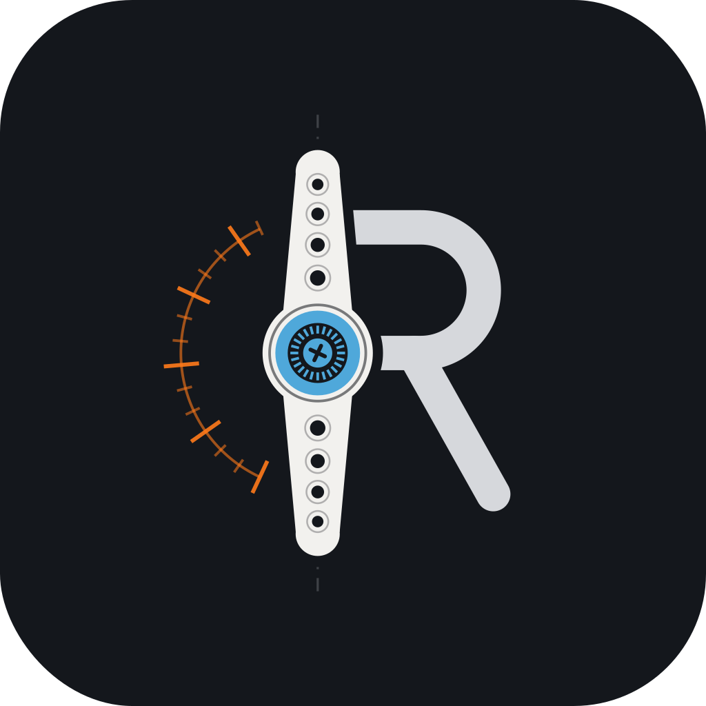
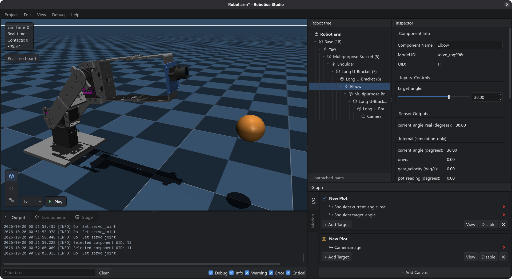

<p align="center">
  
</p>

<h1 align="center">RoboticsStudio</h1>

<p align="center">
  <b>A zero-setup simulator for hobby-grade robots, built on MuJoCo.</b>
</p>

<p align="center">
  
  
  
  
</p>

<p align="center">
  <a href="#overview">Overview</a> ·
  <a href="#getting-started">Getting Started</a> ·
  <a href="#features">Features</a> ·
  <a href="#programming">Programming</a> ·
  <a href="#documentation">Documentation</a> ·
  <a href="#roadmap">Roadmap</a>
</p>

<p align="center">
  
</p>

---

## Overview

Cheap robot parts are imperfect. Servos have backlash, IMUs drift, and batteries sag under load. Code that works in an ideal simulator often fails on real hardware, and full-scale simulators take significant setup to model these effects.

RoboticsStudio ships parts with their flaws already modelled. Assemble a robot, write an Arduino sketch, and press Play. The same sketch compiles for a real board.

**Workflow**

1. **Assemble** the robot from the component library.
2. **Program** it with a C++ Arduino sketch.
3. **Run** it in lockstep with the physics and watch live telemetry.
4. **Transfer** the same sketch to a real Arduino Uno or ESP32-CAM.

Runs on an ordinary Linux laptop. No dedicated GPU required.

## Getting Started

### Download

Download the latest AppImage from the [Releases page](https://github.com/alfaiajanon/RoboticsStudio/releases/latest) and run it:

```bash
chmod +x RoboticsStudio-Linux-x86_64.AppImage
./RoboticsStudio-Linux-x86_64.AppImage
```

### Build from source

```bash
git clone https://github.com/alfaiajanon/RoboticsStudio.git
cd RoboticsStudio
tools/fetch_wasi_sdk.sh   # one-time: firmware compiler
./run.sh
```

## Features

| Feature | Description |
| --- | --- |
| **Visual assembly** | Drag and drop servos, DC and stepper motors, IMUs, cameras, displays, brackets and wheels. |
| **Realistic parts** | Each part follows its real mechanism: deadband, backlash, noise, torque limits, lost steps. Parameters come from datasheets or measurements. |
| **C++ firmware** | Arduino sketches compiled in the app and run in lockstep with the physics. |
| **Prototype and Real levels** | Prototype wires everything automatically. Real uses an actual board, wired pin by pin, with checks for common wiring mistakes. |
| **Power** | At the Real level supplies sag under load: batteries, bench supplies, regulators and the boards' USB feed. A stalling servo can brown out the board, which then resets as a real one does. |
| **Stage** | Environment, floor and props, driven by a JavaScript stage script. |
| **Live telemetry** | Real-time plots of any input, output or body motion. |
| **Component editor** | Create custom parts as `.rsdef` JSON files. |

### Supported hardware

| Category | Parts |
| --- | --- |
| Boards | Arduino Uno, ESP32-CAM |
| Power | 4×AA pack, 9 V battery, 2S LiPo, bench supply, LM2596 buck converter |
| Actuators | SG90 and MG996R servos, 60 RPM DC gear motor, NEMA 17 stepper |
| Sensors | MPU6050 IMU, OV7670 camera, depth camera |
| Displays | 160x128 ST7735 TFT |
| Structural | Multipurpose bracket, long U bracket, 65 mm wheel |

## Programming

Robots are programmed as standard Arduino sketches. At the Real level a sketch uses the board's own pins (`servo.attach(9)`, `analogRead(A0)`), as on the bench. At the Prototype level (an ideal board, no real pins) the pin names come from a generated `robot_pins.h`:

```cpp
#include <Servo.h>
#include "robot_pins.h"

Servo shoulder;

void setup() {
  shoulder.attach(SHOULDER_SIGNAL, 1000, 2000);
}

void loop() {
  shoulder.write(45);
  delay(500);
  shoulder.write(135);
  delay(500);
}
```

- **Simulated time.** `delay()`, `millis()` and `micros()` follow simulation time, so runs are exact and repeatable.
- **Real interfaces.** Parts are reached through pins, `Wire`, `SPI`, `Adafruit_ST7735` and `esp_camera`.
- **Portable.** Demo sketches are compiled for real boards with `arduino-cli` on every push.

Example sketches for each part are in [`examples/firmware`](examples/firmware).

## Demos

Each demo in [`demo/`](demo) is provided at both levels.

| Demo | Description | Real board |
| --- | --- | --- |
| Robot arm | Three-servo arm that finds and tracks an orange ball with its camera. | ESP32-CAM |
| Servo Comparison | An emulated SG90 next to an ideal one, sweeping together. | Arduino Uno |
| DC Motor | A 12 V gearmotor with a wheel on a stand: ramp, brake, reverse. The Real copy drives it through an L298N from a 2S LiPo. | Arduino Uno |

## Documentation

| Topic | Guide |
| --- | --- |
| Using the app | [overview.md](docs/user/overview.md) |
| Firmware | [firmware.md](docs/user/firmware.md) |
| Levels, boards and wiring | [wiring.md](docs/user/wiring.md) |
| Stage | [stage.md](docs/user/stage.md) |
| Creating parts | [Basics](docs/user/component_basics.md) · [Power block](docs/user/create_power.md) · [Servo](docs/user/create_servo.md) · [Stepper](docs/user/create_stepper.md) · [DC motor](docs/user/create_dc_motor.md) · [Motor driver](docs/user/create_driver.md) · [IMU](docs/user/create_imu.md) · [Structural](docs/user/create_structural.md) · [Camera](docs/user/create_camera.md) · [Display](docs/user/create_display.md) |
| Developer docs | [docs/dev](docs/dev/overview.md) |

## Roadmap

| Status | Item |
| --- | --- |
| Done | Simulated time as the only clock, reproducible runs |
| Done | Device models along the real signal path |
| Done | C++ firmware with the Arduino API |
| Done | Boards and wiring (Uno, ESP32-CAM) |
| Done | Power: supply sag, current budget, brownout resets, batteries |
| Planned | Multiple boards linked over UART |
| Done | Motor drivers (L298N, TB6612FNG), DC motors as circuits, board pin strength |
| Planned | Interface boards: PCA9685, level shifters |
| Planned | Built-in robotics library: kinematics, IK, PID, filters |
| Planned | Validation against measurements of real parts |

Full design: [architecture-v2.md](docs/dev/architecture-v2.md).

## Contributing

Contributions of new part profiles (`.rsdef`) are welcome. Every error parameter must cite its source: a datasheet link or a description of how it was measured.
