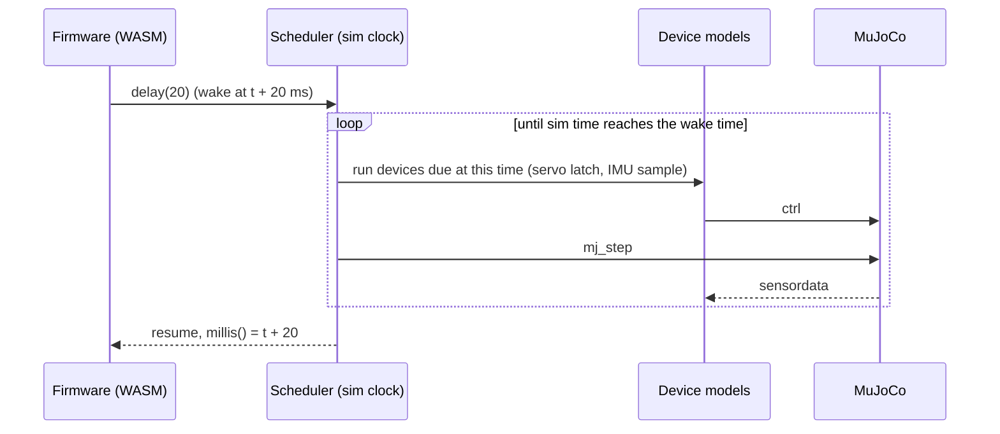
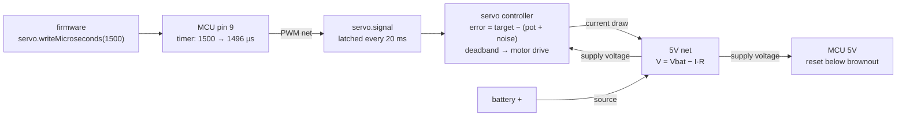

# Architecture v2 (target design)

This is the design RoboticsStudio is moving towards. It describes the **target state**, not today's code; for how the app works now, see [overview.md](overview.md) and [sim-to-real.md](sim-to-real.md). The task list and phase order live in `temp/plan.md`.

## 1. Goals and non-goals

**Positioning.** A zero-setup simulator for hobby-grade robots: measured models of cheap parts, and firmware that runs unchanged on the real board. Education comes first; code transfer is the proof that what the user learns is real.

A robotics simulator in the usual sense (ROS/Gazebo) is one where the same control software drives the simulation and the real robot, and the simulator only replaces the hardware behind it. v2 meets that bar at the microcontroller level: the user's firmware is a real Arduino sketch, and the simulator replaces the board's pins, buses and the parts wired to them.

Goals:
- Simulated time is the only clock; runs are reproducible.
- Part errors follow the part's internal mechanism, with parameters taken from datasheets or measurements.
- Wiring, pins, buses and power are part of the model at the *Real* level.
- Firmware is C++ against the Arduino API, compiled to WebAssembly in the app, and also compiles for the real board.
- A built-in robotics library (kinematics from the assembly, IK, trajectories, control, filters).

Non-goals for now:
- **Advanced level** (a companion computer next to the MCU, ROS 2 bridge, MoveIt/Nav2). Deferred, but kept possible: see [Hooks for Advanced](#hooks-for-advanced).
- Circuit simulation (SPICE), bit-level bus simulation, cycle-accurate MCU emulation.
- Non-Linux platforms.

## 2. Levels

A project has a **level**. Levels are not separate engines: every level uses the same netlist and device models. They differ in the **boards** the firmware runs on, and so in how much of the electronics the user deals with.

| Level | Boards | Pins | Electrical |
|---|---|---|---|
| Prototype | One ideal controller, implicit | Unlimited, assigned automatically, hidden | Ideal: no power limits, no bus time |
| Real | Any number of real boards (Uno / Mega / ESP32 / ...), added by the user | Each board's real pin map | Power budget, bus timing, voltage levels |
| Advanced (later) | Real boards + companion computer | As Real, plus the UART link | As Real |

- **Firmware belongs to a board, not to the robot.** Each board has a firmware slot holding its sketch, and runs it on its own `FirmwareRuntime` and lockstep gate; all boards share sim time, so a multi-board run is still deterministic.
- **Prototype** is one ideal brain: a single implicit ideal controller that auto-wires every part, with as many channels of each kind as the robot needs, so auto-wiring cannot run out of pins. The user focuses on behaviour; pins and electronics stay hidden. Prototype stays single-board.
- **Real** is the actual electronics. A Real project **starts with no board**: the user adds boards from the component library like any other part (an Uno for the motors and an ESP32-CAM for vision, a Nano per leg, ...), wires them, and gives each its firmware. Boards talk to each other over wired buses (UART, I2C). Multiple boards arrive together with the UART bus model; a board-to-board link is what makes more than one useful. Without a board, Play runs the physics only and the design-rule check says so.
- **A project's level is fixed** (settled 2026-10-21). **Prototype → Real is one way, into a new project**: "Create Real copy" leaves the Prototype project as it is (`Project::createRealCopy`). There is no Real → Prototype.
  - Today the copy has the same robot and sketches, no board and no wiring, plus a `robot_pins.h` that is the user's own: the Prototype's names set to -1 ("not wired yet"), for the user to fill in with board pins.
  - Later the migration wizard does the mapping: it adds (or offers) the board(s), maps the ideal wiring onto them, writes those pins, and lists what does not fit with suggested fixes: not enough PWM pins (add a PCA9685, or pick a Mega), an I2C address clash, a pin that is not interrupt-capable, a 5 V signal into a 3.3 V part, power budget exceeded. The Prototype sketch goes into the first board's firmware slot.
- **Pins at the Real level are the board's own** (settled 2026-10-21, replacing the generated per-board `robot_pins.h`): a sketch writes `servo.attach(9)`, `analogRead(A0)`, `LED_BUILTIN`, as on the bench.
  - The board's names and macros come from the real Arduino core's variant, recorded in the board's `.rsdef` (`board.variant`) and compiled in as `pins_arduino.h` + `-D` flags, so the sketch is the same file the real board gets.
  - The Prototype level, which has no physical pins, keeps generated names (`robot_pins.h`).
  - The firmware API is the same at every level.

## 3. Time model

Simulated time is the only clock. Wall-clock time only decides how fast simulated time advances (real-time pacing, time scale, or "as fast as possible").

- Physics steps at `opt.timestep`.
- The MCU runs in **lockstep**. Firmware runs until it calls `delay()`/`yield()` or uses up its time slice; then physics catches up to that simulated time, and the MCU continues. `millis()`, `micros()` and `delay()` read simulated time.
- Each device model runs at its own rate in simulated time: a servo latches its pulse at 50 Hz, an IMU updates at its output data rate, a camera at its fps. This generalises today's `Cadence` (Synchronous / Throttled / Async).
- All randomness is seeded: one seed per project, from which each part instance gets its own seed (for per-unit variation). Same seed, same run.
- The stage script also runs on simulated time.
- Optional later: charge firmware compute time to the simulated clock (WASM instruction metering), to model a slow MCU.

## 4. Netlist

### Wires and nets
In the editor the user draws **two-point wires** between pins. At load the app groups pins joined by wires (directly or through other wires) into **nets**. The simulation works on nets, not wires, because many real connections are not "copy A to B":

- power and ground join many pins;
- one MCU pin can drive two servos (fan-out);
- I2C is bidirectional and shared by several devices;
- two outputs wired together are a fault, not an overwrite;
- an input with nothing driving it is floating, not 0.

### Pin roles
Each pin in a `.rsdef` has a role: **driver** (output), **receiver** (input), **bidirectional** (open-drain, e.g. I2C SDA), **source** (battery +, regulator output) or **load** (a VCC pin that draws current).

### Net kinds
| Kind | Value | Resolution |
|---|---|---|
| Digital | level + time of last change | 0 drivers: floating (or the pull-up value); 1: its level; 2 or more: conflict |
| PWM | period, pulse width | set by the driver's timer, rounded to its resolution; edges are not simulated |
| Analog | voltage | from the driving source |
| Bus (I2C, SPI, UART) | transactions | the master addresses a device; that device's model answers; the transfer takes bus time (bytes × bit time) |
| Power | voltage, total current | source voltage − total load current × internal resistance, limited by the regulator |

Values change on **events**: a driver changes the net at a simulated time, and receivers see the new value when *they* sample it (a servo at the start of its next 20 ms frame). Latency then comes from the devices, not from the order of the simulation loop.

Faults found at load or during the run: floating inputs, driver conflicts (shorts), I2C address clashes, missing ground, unpowered parts, voltage-level mismatches, power budget exceeded. These feed the design-rule check and the migration report.

### Errors live at the pins, not on nets
Nets are ideal. Every error belongs to a pin model at one end: timer quantization and jitter on an MCU output, frame latch and per-unit offset on a servo input, resolution and reference voltage on an ADC input. This keeps every error tied to a real part and a datasheet number. Prototype needs no special code: the ideal board's pins have no quantization and its power net has no resistance.

### Worked example: MCU → servo, with power

1. Firmware calls `writeMicroseconds(1500)`. The pin's timer rounds it to its step and sets the PWM net.
2. The servo latches the pulse at its next frame and runs its internal loop: error against the noisy pot reading, deadband, motor drive.
3. The motor draws current from the 5V net. At stall the net sags; the servo's torque drops, and if the voltage falls below the MCU's brownout threshold, the MCU resets. No special-case code is needed for this classic failure.
4. A missing GND wire is flagged by the design-rule check before Play.

**Built (Phase 2, power pass):** `Document/PowerNetwork` (rails, supplies, regulators, loads, ground domains; a few-pass DC solve) and `Simulation/Power/PowerSystem` (per step, with the parts' live currents; part on/off at `min_v`; MCU brownout reset and restart; batteries with a per-cell discharge curve that continues past the rated cut-off, a Kinetic Battery Model for the rate-capacity and recovery effects, over-discharge warnings and an optional protection circuit). Parts: the boards' USB feed and regulators, 4×AA, 9 V, 2S LiPo, bench supply, LM2596 buck. Design rules: back-feeding, ranges on every rail, regulator headroom, typical/peak budget, brownout at peak, common ground. User guides: [wiring.md](../user/wiring.md#power), [create_power.md](../user/create_power.md). Not yet: polyfuse trip.

**Built (Phase 2, pass 2: motor drivers):** the DC motor is a two-terminal circuit at the Real level (pin types `motor` / `motor_out`); `PinBus` carries each net's source (a driver output, a board pin with the board's `pin_output_ohm`, ground) and the current back; `HBridgeEmulatorCpp` (L298N, TB6612FNG modules) with the datasheets' drops and truth tables; a pin's current over `pin_abs_max_ma` is warned about and loads the board's rail; design rules for motor-to-pin wiring, shorted outputs, per-channel current, L298N jumpers, and the stall current through drivers in the budget. Prototype behaviour is unchanged (same torque table). Demo: `DC Motor` / `DC Motor (Uno)`.

## 5. Boards

A board is a component like any other, with many pins and a **firmware slot** (the sketch it runs, a file in the project). At the Real level the user adds boards from the component library like any other part, as many as the robot needs. Its `.rsdef` lists the pin capabilities: PWM-capable pins, interrupt pins, ADC channels and resolution, I2C/SPI/UART pins, logic voltage (3.3 V / 5 V), and regulator current.

- **Ideal controller** (Prototype): unlimited channels of every kind, ideal electrical behaviour.
- First real boards: Arduino Uno, Mega, an ESP32 dev board.
- Interface parts are ordinary components with pins on both sides: PCA9685 (I2C PWM driver), motor drivers (L298N, TB6612: built), level shifters, battery packs, buck converters (built).

## 6. Device models

`DeviceModel` replaces today's `Emulator`. Today one `QObject` is both the script API and the error logic. In v2 a device model has pins and an **ordered chain of steps** that follows the physical signal path, and the script API moves into the firmware library (section 7).

Step library: quantize, jitter, per-unit offset/gain, latch/rate, delay, deadband inside the loop, rate limit, saturation, noise at the point of measurement. **Settled (2026-10-19): every device composes the steps in code, in physical order** (`Simulation/ErrorSystem/Steps.h`); `.rsdef` lists only the parameters. Actuators have feedback loops (a servo's controller, a stepper's rotor) that a flat list can't express.

**Built:** servo, DC gear motor (ideal H-bridge on two pins), stepper (STEP/DIR, real torque-angle curve), MPU6050 (I2C register map + measurement chain), ST7735 TFT (SPI controller), camera (esp32-camera API). Parts on buses register on `Simulation/Controller/DeviceBus` (I2C by address, SPI by CS pin, cameras by SCCB pin); firmware reaches them through `Wire`, `SPI`, the Adafruit display library and `esp_camera` (`resources/firmware`).

Servo, in physical order:

1. PWM pulse from the net (already quantized by the MCU timer);
2. latched once per 20 ms frame; limp until the first pulse;
3. per-unit offset and gain;
4. controller: `error = target − (output position + pot noise)`;
5. deadband on that error;
6. motor drive with speed and torque limits, scaled by the supply voltage;
7. gearbox backlash, inside the loop (the pot sits on the output shaft).

Rules:
- **Noise only where an analog quantity is measured** (pot, ADC, sensor), at the size the datasheet or a measurement gives. Never on a clean digital command.
- **Feedback honesty.** Firmware reads only what the real part exposes. Values the real part does not provide (the true angle of an SG90) stay visible in plots and are marked *simulation-only*.
- **Parameter sources.** Every error parameter in a `.rsdef` carries a `source`: a datasheet link, or a measurement (what, how, when). `validate_rsdef.py` warns when one is missing.

## 7. Firmware runtime

- The robot's firmware is C++ against the Arduino API, compiled in the app to WebAssembly with a bundled toolchain (wasi-sdk clang) and run in an embedded runtime (WAMR: C, small, fast interpreter).
- **Built (Prototype level, first milestone):** `Simulation/Firmware/FirmwareRuntime` (WAMR 2.4.5, `extern/wamr`, built by `cmake/wamr/`) and `FirmwareCompiler` (wasi-sdk 34, fetched by `tools/fetch_wasi_sdk.sh`, a trimmed copy bundled in the AppImage); the core in `resources/firmware` (`rs_abi.h` imports, `Arduino.h`, `Print`/`Serial`, `String`, `Servo`); pins through `Simulation/Controller/PinBus` from `Document/IdealBoard` (`robot_pins.h`). Not yet: `Wire.h` and the part libraries. User guide: [docs/user/firmware.md](../user/firmware.md).
- **Arduino core shim:** `setup()`/`loop()`, `pinMode`, `digitalRead`/`digitalWrite`, `analogRead`/`analogWrite`, `millis`, `micros`, `delay`, `Serial` (to the Output panel), `Servo.h`, `Wire.h`, plus libraries for the shipped parts (MPU6050, PCA9685, camera, display). Everything goes through the board's pins and the netlist.
- **Prototype convenience:** the same sketch structure; parts are reached through generated pin names (`robot_pins.h`: `COMP_<uid>_<PIN>`, plus `<NAME>_<PIN>` for uniquely named parts), because the ideal board has no physical pins. At the Real level a sketch uses the board's own pins (section 2); a Real copy keeps the names in a `robot_pins.h` the user owns. (Settled 2026-10-19 instead of `comp_N` handles; Real-level pins settled 2026-10-21.)
- **Transfer rule:** every demo sketch must also compile with `arduino-cli` for its real board. CI checks this.
- **JavaScript** stays only for stage scripts (the `QJSEngine` stage controller, `prop_<id>` and `robot`). Done in Phase 7: robot JS scripts were removed and the demos ported to C++.

## 8. Robotics library

- The **kinematic chain** is extracted from the assembly: joints, axes and link transforms from the connector chain. Firmware can query it, so sketches no longer hard-code geometry (as `demo/Robot arm/script/robot_arm/robot_arm.ino` does today).
- A small C++ library on top: forward kinematics, analytic and numeric IK, trajectory generation (trapezoid, S-curve), PID with anti-windup, filters (low-pass, complementary, alpha-beta), diff-drive odometry.
- It runs as part of the firmware and uses only the sensors the robot actually has; it never reads simulation-only values.
- Optional: URDF export from the same chain.

## 9. UI placement

Built in Phase 2 (core slice); user guide: [wiring.md](../user/wiring.md).

- The **Wiring page** (`View/Panels/Wiring/WiringPage`, Ctrl+3) is a page in the editor's central page stack, next to the 3D View and the Script page, shown only at the Real level. It is a **schematic canvas** (`SchematicScene`: part blocks with their typed pins, two-point wires dragged from pin to pin, routed around the blocks), with the design-rule findings and the net list beside it. Wires, block moves, the level and a board's firmware slot are undoable commands (`Commands/WiringCommands.h`).
- The script page is the **firmware** page (C++) for the robot; stage scripts keep the JS editor. At the Real level a sketch's entry names the board(s) running it.
- The New Project dialog asks for the **level** (Prototype by default). A Real project starts with no board.
- The level lives in the project settings (Inspector, nothing selected, above the firmware list) and in a HUD badge in the 3D view ("Prototype · ideal board", "Real · Uno"); clicking the badge opens the settings. The level is shown, not switched; a Prototype project has **Create Real copy...** there.
- Selecting a board shows its firmware slot (pick a sketch, open it) and what is wired to each of its pins. The first board added at the Real level takes over the Prototype sketch.
- Still to come: the migration wizard (Prototype → Real), several boards running at once (with UART), Serial tagged by board.

## 10. What stays and what changes

| Stays | Changes |
|---|---|
| `Document/`, `Commands/`, `View/` structure | `MicroController` → WASM firmware runtime (robot); `QJSEngine` stays for the stage |
| MJCF generation (`Project::generateMujocoXML`) | `Simulation/ErrorSystem/` emulators → device models with pins and step chains |
| `Stage`, `CameraRenderer`, `DisplayTextures` | `SimulationManager::physicsLoop` → sim-time scheduler with lockstep MCU |
| `Telemetry/` | `.rsdef` / `.rsproj` → schema 3 (typed pins, nets, level, board, parameter sources) |

The layering rules stay: `Document/` and `Simulation/` don't include `Application/Application.h`, and the View changes authored state only through commands (wiring edits included).

## 11. Open questions

- ~~**Schema 2 → 3.**~~ Settled: a load-time upgrade. Schema 3 only adds optional fields, so schema 2 files load as they are (a schema 2 project is a Prototype project without wiring) and are saved as 3; `tools/convert_schema3.py` updates files in place.
- ~~**Toolchain size.**~~ Settled: the trimmed wasi-sdk is ~165 MB unpacked, ~38 MB compressed; a sketch compiles in 0.15–0.5 s (the core once, ~1 s, then cached).
- ~~**Lockstep mechanics.**~~ Settled: each controller runs on its own thread; the lockstep gate (`Simulation/Controller/LockstepGate`) hands control back and forth, and firmware calls that take time (`delay`) block inside the WAMR native call. No coroutines needed. The watchdog uses `wasm_runtime_terminate` (requires WAMR's thread manager).
- ~~**Servo actuator.**~~ Settled: the servo's controller drives a `motor` actuator (torque), see section 6.
- **CPU cost.** Model firmware compute time at all, and per board?
- ~~**Camera at the Real level.**~~ Settled: a board with a built-in camera (the ESP32-CAM) carries the camera device in its own `.rsdef`, with the camera pins `internal` (wired on the PCB, named `<BOARD>_<PIN>` in `robot_pins.h`). A separate camera module (OV7670) is a part wired to a board like any other.

## Hooks for Advanced

Nothing is built for the Advanced level now, but these choices keep it possible:
- the UART net kind is the future link between the MCU and a companion computer;
- boards are components with a firmware slot, so a "Raspberry Pi" board can be added later;
- simulated time sits behind one clock interface, ready to be published as a ROS `/clock`;
- the kinematic chain and URDF export are what MoveIt needs.
