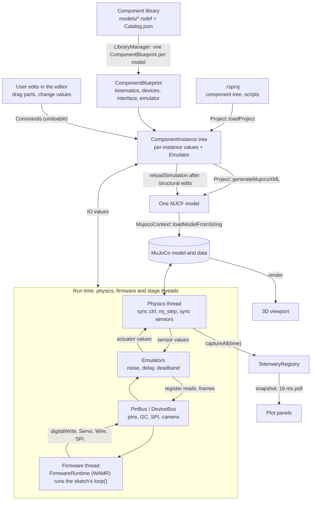

# RoboticsStudio Overview

This page describes the app as it works today. The target design it is moving towards is in [architecture-v2.md](architecture-v2.md).

RoboticsStudio is a desktop robotics simulator (Qt 6, C++17, MuJoCo 3.3.7). A user assembles a robot from library components, writes an Arduino sketch in C++ (compiled to WebAssembly in the app; the same file compiles for a real board), and watches it run in physics with realistic hardware errors and live plots.

## Pipeline

## Stages

1. **Library.** Each component is an `.rsdef` JSON file (see [schema2.md](schema2.md)) listed in `models/Catalog.json`. `LibraryManager` loads one `ComponentBlueprint` per model. A blueprint knows how to emit the MJCF pieces for its component and which signals it exposes.
2. **Project.** An `.rsproj` describes an assembly: component instances linked parent to child through connectors, parameter overrides and script paths. Opening it builds the `ComponentInstance` tree, creates an `Emulator` per instance, and clears the undo stack.
3. **Editing.** The editor mutates the document only through undoable commands ([command.md](command.md)). Structural edits trigger `reloadSimulation()`, which regenerates the whole MJCF from the tree, reloads MuJoCo and re-resolves MuJoCo ids for every signal.
4. **Model generation.** `Project::generateMujocoXML` walks the tree, positions each component through its connector transform and snap angle, and asks each blueprint for body, actuator, sensor, tendon and contact XML. Everything is prefixed `comp_<uid>_` so one model holds many components.
5. **Simulation.** `SimulationManager` has three states:
   - `EDITING`: joint values drive `qpos` and `mj_forward` runs, with no stepping, so parts can be posed. Switching to it stops the firmware and the stage script, resets emulators and resets MuJoCo data.
   - `PLAYING`: the physics thread steps the model one `mj_step` at a time and the firmware and stage script run in lockstep with it (sim time is the only clock; the time scale or Max only sets how many steps run per wall second).
   - `PAUSED`: all threads idle.
6. **Signals.** Every component exposes named interface signals (inputs and outputs). Each physics step: write input values to `ctrl` (degrees converted to radians), `mj_step`, read `sensordata` back into output values (radians to degrees), run the emulators. Each emulator declares a cadence: every step, throttled to a sim-time period, or async (sampled inside the step loop, heavy work done on a worker; see [sim-to-real.md](sim-to-real.md)). Image signals (camera outputs, display inputs) live in `ImageIOValue`s next to the numeric values.
7. **Firmware.** On Play, `FirmwareCompiler` compiles the sketch (`.ino`/`.cpp`) to WebAssembly with the bundled wasi-sdk clang, and `FirmwareRuntime` runs it in the embedded WAMR interpreter on its own thread: `setup()` once, then `loop()`, but only while the physics thread has released it for the current step (lockstep hand-off, `Controller/LockstepGate`). The sketch reaches parts only through their real interfaces: pins on `PinBus` (built from `Document/IdealBoard`, named in the generated `robot_pins.h`) and buses on `DeviceBus` (I2C, SPI, the camera's SCCB). Time functions use sim time; all randomness is seeded from the project seed, so runs repeat. A `.js` robot script (JavaScript robot scripts were removed) is refused at Play: physics runs, the robot stays idle. The stage script is the only JavaScript left: `MicroController` runs it in a `QJSEngine` on its own thread, with the same lockstep gate ([stage.md](../user/stage.md)).
8. **Observation.** The viewport renders the MuJoCo state. `TelemetryRegistry` sources capture signals and body motion every 10 ms of sim time for the plot panels ([telemetry.md](telemetry.md)).

## Code map

| Folder (`src/`) | Role |
|---|---|
| `Document/` | `Project`, `ComponentData`/`ComponentBlueprint`/`ComponentInstance`, `LibraryManager`, `DeviceTypes`. No widgets. |
| `Commands/` | Undoable edits. The only way the View mutates authored state. |
| `Simulation/` | `SimulationManager` (threads, sync, emulator schedule), `MujocoContext`, `Firmware/` (`FirmwareCompiler`, `FirmwareRuntime`), `MicroController` (stage JS), `Controller/` (`LockstepGate`, `RobotController`, `PinBus`, `DeviceBus`), `ErrorSystem/` emulators, `Rendering/` (`CameraRenderer`). |
| `Telemetry/` | Registry, sources, storage buffers. |
| `View/` | Windows (launcher, editor, component editor), panels, OpenGL viewports. |
| `Application/` | Singleton that owns the project, simulation manager, editor and undo stack. |

## Threads and locking

| Thread | Work | Shared state |
|---|---|---|
| UI | Qt widgets, commands, plot polling | Mutates the document, reads telemetry |
| Physics | Pacing, stepping, releasing the scripts each step, signal sync, emulators, telemetry capture | `physicsMutex` guards the MuJoCo model and data; reloads take the same lock. `stepMutex` is held for a whole step (play/edit take it) |
| MCU, stage | Run user `loop()`, one at a time and only while released by the physics thread | Talk to components only through emulators and `ComponentInstance` IO values (`ioMutex`) |
| Camera render | `CameraRenderer` worker: GL render + readback of camera scenes the physics thread queued, emulator post-processing. Display frames reach every GL context (this one and the viewport) through `DisplayTextures` (collected on the physics thread, uploaded with `glTexSubImage2D` into each context's copy of the screen texture) | Own GL context and `mjrContext`; takes `physicsMutex` only to rebuild its GPU context after a model reload. Model reloads go through `SimulationManager::reloadModel` so queued frames of the old model are dropped |

Two layering rules: `Document/` and `Simulation/` must not include `Application/Application.h`, and only commands change authored state from the View. Runtime values written by the simulation are not undoable.
