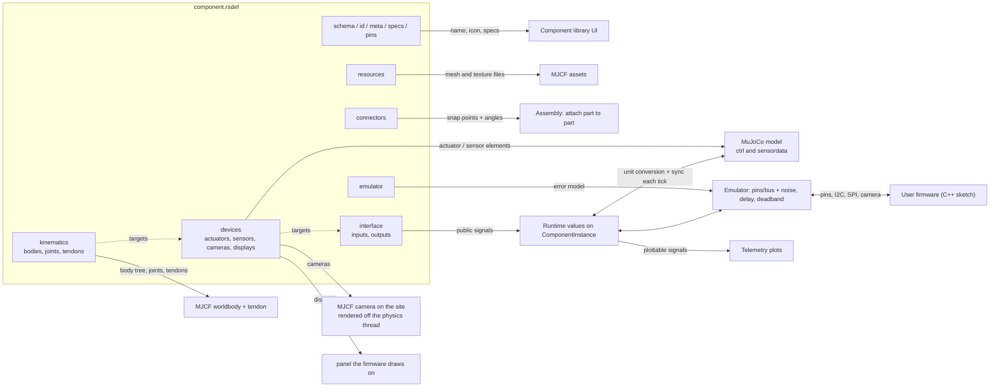

# RSDEF Schema 3 (and 2)

An `.rsdef` file is the JSON definition of one component (servo, IMU, bracket, wheel, board...). It is listed in `models/Catalog.json`, loaded by `ComponentData::fromJson` and turned into a `ComponentBlueprint`. Files are saved as `"schema": 3`. Schema 3 only adds optional fields (board pins, the `board` block; see [Schema 3](#schema-3-boards-and-wiring)), so the loader still reads `"schema": 2` files as they are; anything else (schema 1, a missing `schema`) is rejected, schema 1 keys with a hint. `tools/convert_schema3.py` bumps the repo's files.

Validation: `schema/rsdef.schema.json` covers structure. Cross-references (unique ids, targets that exist, mass rule) are checked by `ComponentData::fromJson` and mirrored in `python3 tools/validate_rsdef.py [paths]`. Valid device types, target kinds, signal widths and the MJCF element each maps to live in one table: `src/Document/Components/DeviceTypes.cpp`.

## Which part does what



Dotted arrows are references by `target {kind, id}`: signals point at devices (or joints), devices point at physical objects (joints, tendons, sites, geoms). Inside a component that chain is `interface signal -> device -> kinematic object -> MuJoCo`.

## Sections

| Key | Contents | Used for |
|---|---|---|
| `schema` | `3` (`2` still loads) | loader gate |
| `id` | model id, top level (not in `meta`) | `.rsproj` references it |
| `meta` | `name`, `version`, `author`, `icon_path`, optional `hint_class` (`actuator`, `sensor`, `vision`, `display`, `mcu`, `weight`, `battery`, `part`; absent = generic) | library panel; `hint_class` picks the robot tree icon. The value list lives in `src/Document/Components/HintClass.h` |
| `specs` | free-form object (`max_torque_nm`, `voltage_max`, `weight_kg`...) | informational; emulators may read it |
| `pins` | `[{id, type?, description, voltage_range?, number?, caps?, internal?}]` | unique `id`s. `type`: `pwm`, `digital`, `analog` (signal pins), `i2c_sda`, `i2c_scl`, `spi_sck`, `spi_mosi`, `spi_miso`, `uart_tx`, `uart_rx` (bus lines), `power`, `ground`; boards also `gpio` (with `number` + `caps`) and `power_out`; `internal` = wired on the board's PCB. Omit `type` while untyped. At the Prototype level the ideal board gives every typed part pin except power/ground a number, `uid * 100 + index` in this list, named `COMP_<uid>_<PIN>` in the generated `robot_pins.h` (`Document/IdealBoard`); at the Real level the board's numbers through the wiring (`Document/RealBoard`) |
| `board` | boards only: `fqbn`, `header_folder`, `logic_voltage`, `adc`, `analog_write`, `i2c`, `spi`, `sources` | makes the part a board (`BoardDef`): its firmware slot, `robot_pins.h` folder and pin limits at the Real level |
| `resources` | `meshes{key: path}`, `materials{key: texture path}` | geoms refer to the keys; paths are relative to the `.rsdef`. Names are prefixed per model when MJCF is generated. |
| `kinematics` | `default_body`, `bodies[]`, `joints[]`, `tendons[]` | physical structure, below |
| `connectors` | `[{id, body, description, transform, mechanics.snap_angles}]` | attach points between components |
| `devices` | `actuators[]`, `sensors[]`, `cameras[]`, `displays[]` (omit empty families) | what MuJoCo drives or measures |
| `interface` | `inputs[]`, `outputs[]` | signals visible to scripts, the Inspector and plots |
| `emulator` | `{type, source, parameters}` | hardware-error model |

## Schema 3: boards and wiring

What schema 3 adds (all optional, so a schema 2 file is a valid schema 3 file apart from the version number):

- **Pin types** `spi_miso`, `uart_tx`, `uart_rx` for parts; `gpio` and `power_out` for boards.
- **Board pin fields**: `number` (required on `gpio` and `internal` pins, unique per board), `caps` (gpio only), `internal`. `gpio`, `power_out` and `internal` are only allowed with a `board` block.
- **The `board` block** (`BoardDef` in `ComponentData.h`). Pin references in `i2c`, `spi` and `analog_write.pins` must name gpio pins with the matching capability. The validator warns about board fields without a `sources` entry, like emulator parameters.

The **`.rsproj`** gets, at the top level:

| Key | Contents |
|---|---|
| `schema` | `3`. Missing = schema 2: loaded as a Prototype project with no wiring, saved as 3 |
| `level` | `"prototype"` (default) or `"real"` |
| `wiring` | `{"wires": [{"a": {"uid", "pin"}, "b": {...}}], "layout": {"<uid>": [x, y]}}`: two-point wires (grouped into nets at load, `Document/Netlist`) and the Wiring page's block positions |

and a board's component entry gets `"firmware": "<sketch>.ino"`, its firmware slot. `script.current` stays the ideal board's sketch (Prototype). Wires to pins that no longer exist are dropped at load with a warning. On save at the Real level the active board's `robot_pins.h` is written to `<project>/<header_folder>/`.

The design-rule checks on the wiring live in `Document/DesignRules` (no widgets); the runtime side (one `PinBus` pin per net, `DeviceBus::restrictTo`, `BoardProfile` in `FirmwareRuntime`) is in [sim-to-real.md](sim-to-real.md).

## kinematics

- **body**: `id`, `transform {pos, quat}`, `geoms[]`, `sites[]`, `overrideGeom` (default false). `mass` and `inertia` are required when `overrideGeom` is true and forbidden otherwise (then mass comes from the geoms, and a geom `mass` is forbidden when it is true).
- **geom**: `id`, `type` (`mesh`, `box`, ...), `mesh`/`material` resource keys or `color`, `size`, `pos`, `quat`, `mass`.
- **site**: `id`, `transform`. A named point on a body; target for accelerometers, gyros and cameras. Sensors are *not* nested in sites.
- **joint**: `id`, `type`, `body_a`, `body_b`, `transform`, `range`, `damping`, `armature`, `frictionloss`, `collision`, and optional `sources` (`{field: string}` for `range`, `damping`, `armature`, `frictionloss`: where the value comes from, like `emulator.parameter_sources`; `validate_rsdef.py` warns when a play-gap joint has no `sources.range`). Actuators and sensors are *not* nested in joints. Several joints may link the same two bodies; they are stacked on the child body in file order (e.g. a servo's `servo_joint` + `backlash_joint`, both `base -> horn`). Every joint in such a stack needs `armature > 0`. Don't put a geom-less helper body between them instead: a jointed helper body breaks MuJoCo's parent/child contact filter, so neighbouring parts start colliding.
- **tendon**: `id`, `type: "fixed"` (only), `terms[{joint, coef}]`. A weighted sum of joints, useful for backlash: one sensor measures the total of a drive joint plus a passive gap joint.

Frames: joint and connector transforms are in the **component root frame**. Geom and site transforms are in the **parent body's local frame**. Quaternions are `[w, x, y, z]`.

## devices

Every device has a unique `id` (across all families), a `type`, and a `target {kind, id}`. Multiple devices may target the same object (a joint can have a position and a velocity sensor; two sites at one origin are no longer needed).

| Family | Types | Allowed target kinds | Width | Extra fields |
|---|---|---|---|---|
| actuators | `position`, `velocity`, `motor` | joint, tendon | 1 | `ctrlrange`, `forcerange`, `kp`, `kv` |
| sensors | `jointpos`, `jointvel` | joint | 1 | |
| | `tendonpos`, `tendonvel` | tendon | 1 | |
| | `accelerometer`, `gyro` | site | 3 | |
| cameras | `rgb`, `depth` | site | image | `resolution [w,h]`, `fovy` |
| displays | (no type) | geom | image | `resolution [w,h]`, `surface {transform, size}` (required) |

Width is fixed by the device type (it matches MuJoCo's `sensor_dim`), so it is never declared by hand.

- **cameras** become an MJCF `<camera>` placed exactly on the target site, so the site's frame is the camera frame: it **looks along the site's −Z axis with +Y up**. `fovy` is the vertical field of view in degrees (0 or omitted: MuJoCo's 45). The generated model sizes MuJoCo's offscreen buffer for the largest camera. `rgb` frames are 3 bytes per pixel; `depth` frames are float meters along the view axis (0 = no return). Frames reach scripts through `camera_emulator` (see [sim-to-real.md](sim-to-real.md)).
- **displays**: the framebuffer (`resolution`) is drawn by the script through `display_emulator`. It shows in the 3D view (and in camera images) on a generated, visual-only screen quad, and in Image canvases of the plot panel. `surface` says where the quad goes: `transform` is in the target geom's parent body frame (like geoms and sites), and `size` is the half-extents `[hx, hy]` in meters. The screen faces the surface's **+Z**, image right is **+X** and image up is **+Y** (pixel 0,0 at the −X,+Y corner). Put it about 0.1 mm in front of the geom's face to avoid z-fighting. The component editor's "Fit Surface to Geom" does that for box geoms. Until the script sends a frame, the screen is a dark panel.

## interface

Each signal has a unique `name` (across inputs and outputs), optional `unit`, `physical` (does a real pin or wire carry it, or is it a simulator-only convenience), optional `internal` (default `false`: the part's own internal state, such as a servo's motor drive or pot reading; the plot picker and the Inspector list these in a separate "Internal (simulation-only)" group instead of with the part's inputs and outputs), optional `domain`, optional `componentLabels` for vector legends, and a `target`.

| Direction | Allowed target kinds | Resolves to |
|---|---|---|
| inputs | `joint` | the first actuator that targets that joint (warns if none) |
| | `actuator` | that actuator directly |
| | `display` | a display's framebuffer (image) |
| | `emulator` | no MuJoCo object; the emulator owns it |
| outputs | `sensor` | that sensor's data |
| | `camera` | a camera's newest frame (image) |
| | `emulator` | no MuJoCo object; the emulator owns it |

- `domain`: `{"type": "ranged", "parameters": {"min": a, "max": b}}` or `{"type": "unbounded"}` (default). Advisory only: the range of the signal in its own unit.
- `unit`: angular units are converted at the MuJoCo boundary (`Document/Components/Units.h`): `degrees` / `deg` / `degree` to radians, and `degrees/s` / `deg/s` / `degree/s` / `dps` to rad/s. Any other unit is passed through unchanged. Users therefore see and author angles in degrees only.
- An actuator's `ctrlrange` is authored in the unit of the input signal that drives it (an input targeting the actuator, or a joint input whose first actuator it is), and converted the same way when the MJCF is generated. A servo with a `degrees` signal writes `ctrlrange: [-90, 90]`. An actuator no signal drives keeps raw MuJoCo units. `forcerange`, `kp` and `kv` are not converted (N·m, N·m/rad, N·m·s/rad).
- `emulator`-kind signals must also give `channel_type` (`scalar` or `vector`) and `dim`. For every other kind these keys are forbidden, because shape and width come from the target device.
- Runtime values are floats only; there is no `data_type`.

## emulator

`type` selects the C++ class in `EmulatorFactory` (`servo_emulator`, `stepper_emulator`, `dc_gear_emulator`, `imu_emulator`, `camera_emulator`, `display_emulator`, `default_emulator`). An empty type falls back to `default_emulator`. `parameters` is a free-form object read by the emulator (the servo's are listed in [create_servo.md](../user/create_servo.md#emulator)). `parameter_sources` maps each parameter to where its value comes from: a datasheet, a measurement (what, how, when), or `"estimate: ..."`; `validate_rsdef.py` warns about parameters without one. `source` is reserved for a custom emulator script and is currently unused.

## Minimal example

A hinge servo: one body pair, a position actuator and sensor, and the two public signals.

```json
{
  "schema": 2,
  "id": "mini_servo",
  "meta": { "name": "Mini Servo", "version": "1.0.0", "author": "me", "icon_path": "icon.png" },
  "resources": { "meshes": {}, "materials": {} },
  "kinematics": {
    "default_body": "base",
    "bodies": [
      { "id": "base", "transform": { "pos": [0,0,0], "quat": [1,0,0,0] },
        "geoms": [{ "id": "base_geom", "type": "box", "size": [0.01,0.01,0.01], "pos": [0,0,0], "quat": [1,0,0,0], "mass": 0.01 }] },
      { "id": "horn", "transform": { "pos": [0,0,0.02], "quat": [1,0,0,0] },
        "geoms": [{ "id": "horn_geom", "type": "box", "size": [0.01,0.002,0.001], "pos": [0,0,0], "quat": [1,0,0,0], "mass": 0.001 }] }
    ],
    "joints": [
      { "id": "hinge", "type": "hinge", "body_a": "base", "body_b": "horn",
        "transform": { "pos": [0,0,0.02], "quat": [1,0,0,0] }, "range": [-90, 90], "damping": 0.01 }
    ]
  },
  "connectors": [
    { "id": "base", "body": "base", "description": "bottom", "transform": { "pos": [0,0,-0.01], "quat": [0,1,0,0] },
      "mechanics": { "snap_angles": [0, 90, 180, 270] } }
  ],
  "devices": {
    "actuators": [{ "id": "motor", "type": "position", "target": { "kind": "joint", "id": "hinge" },
                    "ctrlrange": [-90, 90], "forcerange": [-0.2, 0.2], "kp": 5, "kv": 0.5 }],
    "sensors": [{ "id": "pos", "type": "jointpos", "target": { "kind": "joint", "id": "hinge" } }]
  },
  "interface": {
    "inputs": [{ "name": "target_angle", "unit": "degrees", "physical": true,
                 "domain": { "type": "ranged", "parameters": { "min": -90, "max": 90 } },
                 "target": { "kind": "joint", "id": "hinge" } }],
    "outputs": [{ "name": "current_angle", "unit": "degrees", "physical": false,
                  "target": { "kind": "sensor", "id": "pos" } }]
  },
  "emulator": { "type": "servo_emulator", "source": null,
                "parameters": { "deadband_us": 10 },
                "parameter_sources": { "deadband_us": "datasheet: TowerPro SG90, dead band width 10 µs" } }
}
```

For complete real files see `models/servo/servo_sg90/servo_sg90.rsdef` (servo) and `models/imu/imu_mpu6050/imu_mpu6050.rsdef` (accelerometer + gyro).
