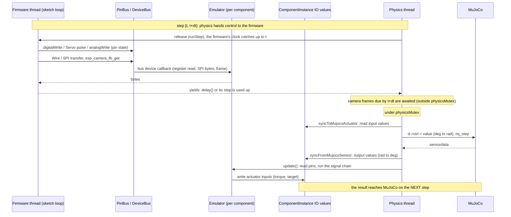

# Sim-to-Real: Error Simulation, Device Models and Firmware

"Sim-to-real" is the right term for this topic. The *sim-to-real gap* is the difference between how a controller behaves in simulation and on real hardware; code tuned against a perfect simulator often fails on a $3 servo with backlash, noisy readings and latency. RoboticsStudio narrows that gap on purpose by injecting hardware imperfections, so firmware that works here has a better chance of working on the bench. (The technique itself is usually called error or noise injection, or hardware non-ideality modelling.)

Imperfection is added at three independent layers:

| Layer | Where | Models | Defined in |
|---|---|---|---|
| Physics | MuJoCo model | friction, damping, rotor inertia, torque limits, backlash, mass | `kinematics` and `devices` of the `.rsdef` |
| Signal | `Emulator` (C++) | the part's electronics along the real signal path: pulse latching, deadband, noise, filters, ranges, bus protocols (register maps, controllers) | `emulator` of the `.rsdef` + C++ class |
| Timing | `FirmwareRuntime` | single-threaded processor in lockstep with the physics, `delay()`/`millis()` on sim time, no parallelism | `Simulation/Firmware`, `Simulation/Controller/LockstepGate` |

## One step of the loop

Sim time is the only clock. The physics thread advances the simulation one `mj_step` at a time (`SimulationManager::stepOnce`); the firmware and the stage script run in lockstep with it, and wall time only decides how many steps run per second (the time scale, or Max).



Consequences worth knowing:

- The firmware never touches MuJoCo or the emulators directly. It drives pins (`PinBus`) and talks on buses (`DeviceBus`); `update()` reads the pins and turns them into the value the physics sees.
- Only one side runs at a time: the physics waits while the firmware or the stage script runs, and they wait while the physics steps. The order (firmware, then stage script, then the step) is fixed, so a run with the same seed repeats exactly.
- `update()` runs after every `mj_step`, and its result is applied on the next step: one step (2 ms by default) of latency on top of any modelled delay.
- Heavy firmware or a slow camera render slows the simulation down (the real-time factor drops) instead of changing what the firmware sees.
- Output values are what the MuJoCo *sensor* reports (the truth). What the firmware reads is the emulator's model of the chip (an IMU's registers, a camera's frames), never the output values directly.
- Switching to Edit mode calls `reset()` on every emulator and resets MuJoCo state. Pressing Play calls `init()` (re-reads parameters, re-seeds the random generators) and reloads the firmware (compiled by `EditorWindow` before the run starts).
- Telemetry is captured every 10 ms of sim time (`kTelemetryPeriod`), not per step.

## Layer 1: physics fidelity

Set in the component file ([schema2.md](schema2.md)); no C++ needed:

- **Joint**: `damping`, `armature` (rotor inertia), `frictionloss`, `range`.
- **Actuator**: `forcerange` (stall torque limit), `ctrlrange` (in the driving signal's unit, so degrees for servos), `kp`/`kv` (a `position` actuator is a PD controller, so it has finite stiffness and overshoot).
- **Mass**: per-geom `mass`, or `overrideGeom` with explicit `mass`/`inertia`.
- **Backlash**: put a loose passive joint in series with the driven joint (small `range`, low damping, `collision: false`), and add a `fixed` tendon summing both with a `tendonpos` sensor. The drive joint moves, the gap joint lets the output wander, and the tendon sensor reports the total angle. Schema 2 allows several sensors per joint and sensors on tendons for exactly this.

## Layer 2: the emulator system (error injection)

> In v2 the emulator layer is replaced by device models with pins and an ordered step chain that follows the physical signal path. Done so far: every part's chain follows its signal path, composed from `Steps.h` blocks, and firmware reaches the parts only through pins and buses. Still to come: the chains as data, and real boards. See [architecture-v2.md](architecture-v2.md#6-device-models).

An `Emulator` is a `QObject` created per `ComponentInstance` by `EmulatorFactory::create(type, comp)`, using the `emulator.type` from the `.rsdef` (empty type gives `default_emulator`; unknown types are logged as errors and the component gets no emulator).

```cpp
class Emulator : public QObject {
    virtual void init();    // Play pressed: read parameters from emulatorDef
    virtual void update();  // per the schedule: apply error model, write actuator values
    virtual void reset();   // Edit pressed: clear internal state

    virtual Schedule schedule() const;          // default: Synchronous
    virtual void sample(const SampleContext&);  // Async only
    virtual void awaitDue(double until);        // Async only: wait for worker results due by `until`

    quint64 seed() const;                       // reproducible per-instance seed
    PinBus* pins;                               // the run's pins (set before init()): read the pins the part receives on
    DeviceBus* buses;                           // the board's I2C/SPI/camera buses: bus parts register here in init()
    const mjModel* physicsModel;                // read-only model/data during update()
    const mjData* physicsData;
};
```

**Cadence.** `SimulationManager` reads `schedule()` at Play and flattens the tree into one list per cadence. Periods are in sim time, so a 30 Hz device stays 30 Hz at any time scale.

| Cadence | When it runs | For |
|---|---|---|
| `Synchronous` | `update()` after every `mj_step`, after the sensor sync | servos, motors, IMUs |
| `Throttled` | `update()` once per period, on the first step past the deadline | low-rate devices (display refresh) |
| `Async` | `sample()` at the exact step that reaches the deadline (`physicsMutex` held), `awaitDue()` before every step (no lock), plus `update()` every step | cameras: `sample()` only builds the scene and queues it on the `CameraRenderer`; the worker renders it; `awaitDue()` waits for frames due by the end of the step; `update()` publishes them |

`sample()` must never block. Delivery is waited for instead, in `awaitDue()`: a frame becomes visible exactly `latency_ms` after capture (and never in the step it was captured in), however fast the host renders. The renderer renders every frame, in order; frames are lost only through `drop_probability` (seeded), a model reload, or more than 32 frames in flight. A frame that takes over 1 s of wall time is published late with a warning.

**Randomness.** Every random generator is seeded from `seed()` in `init()`, never from `random_device`. The seed derives from the project seed (`"simulation": {"seed"}` in the `.rsproj`, Inspector → Random Seed) and the component uid, so the same project and seed give the same run.

Emulators have no script API. A part receives on its pins (`pins->dutyCycle`, `takeRisingEdges`, `state`) or registers on `DeviceBus` as an `I2CDevice`, `SPIDevice` or camera, and the firmware reaches it through those. Parameters come from `emulator.parameters` in the `.rsdef` via `component->getBlueprint()->emulatorDef.parameters`, so a different part (SG90 vs MG996R) is the same class with different numbers.

Registered types:

| `type` | Firmware reaches it through | Model (each class's header comment has the details) |
|---|---|---|
| `servo_emulator` | the `signal` pin (`Servo` library; no feedback wire) | the servo's own controller, in physical order: 50 Hz pulse latch with per-unit phase, limp until the first pulse, per-unit centre/scale, pot on the output shaft (backlash inside the loop) with noise, **deadband on the position error**, saturated proportional drive, DC-motor torque–speed line into a `motor` actuator. See [create_servo.md](../user/create_servo.md) |
| `dc_gear_emulator` | the driver pins `motor_a`, `motor_b` (`analogWrite`; no encoder) | ideal H-bridge (duty, brake, coast), terminal voltage, DC-motor torque–speed line with back-EMF and unit spread; gearbox static friction is the joint's `frictionloss` |
| `stepper_emulator` | `step`, `dir` pins (no encoder) | A4988-style driver: one (micro)step per STEP rising edge; `StepperRotor`: the sinusoidal torque-angle curve, pull-out torque falling with speed, steps lost for good when the rotor falls behind |
| `imu_emulator` | I2C at 0x68 (0x69 with `ad0_high`) | MPU6050 register map (powers up asleep), per-unit scale and bias with random walk, noise density, DLPF, output data rate, range clipping and LSB quantisation |
| `camera_emulator` | the camera driver (`esp_camera.h`), found by its SCCB pin | Async at `fps`. Frames become visible `latency_ms` (sim time) after capture; `esp_camera_fb_get` waits for the next one. rgb: `noise_stddev` (0..255), `color_gain` `[r,g,b]`, `bits_per_channel`; depth: `depth_noise_stddev`, `depth_min`/`depth_max` (outside reads 0); both: `drop_probability` |
| `display_emulator` | SPI, by its `cs` pin (`Adafruit_ST7735`) | ST7735 controller: command set, address window, `MADCTL`, RGB565 GRAM, sleep/reset/backlight. Throttled at `refresh_hz`: publishes the panel when it changed. Drives the first display signal only |
| `default_emulator` | nothing | none (passive parts) |

Every parameter has its source in `parameter_sources` (a datasheet, a measurement, or an estimate to be measured).

### Adding an error model

1. Write a class deriving from `Emulator` in `Simulation/ErrorSystem/`, implement `init/update/reset`. In `init()`, get the part's pins (`pins->ensurePin(uid, id, type)`) and register bus devices on `buses`.
2. Register it in `EmulatorFactory::create`.
3. Set `emulator.type` and `emulator.parameters` in the `.rsdef`. Read parameters in `init()`.
4. Keep errors on the signal path in the order the real signal takes, and build them from the reusable blocks in `Simulation/ErrorSystem/Steps.h` (`FrameLatch`, `UnitVariation`, `Deadband`, `MeasurementNoise`, `DcMotor`, `StepperRotor`, …). Noise goes where an analog quantity is measured, never on a clean digital command. Seed every generator from `seed()`. Give each parameter a source in `emulator.parameter_sources`.
5. Signal names used in `getActuatorValue/getSensorValue` must match `interface` signal names in the `.rsdef`. Those lookups never fail loudly (a missing key returns an empty default value), so a typo shows up as dead behaviour.

Signals with `target.kind: "emulator"` in `interface` are values owned by the emulator itself (for example a battery voltage) rather than by a MuJoCo object.

## Layer 3: firmware and timing

The robot runs a C++ Arduino sketch. On Play, `EditorWindow` compiles it with `Simulation/Firmware/FirmwareCompiler` (bundled wasi-sdk clang, the firmware core in `resources/firmware`, cached builds) and starts the run only if that succeeds. `Simulation/Firmware/FirmwareRuntime` loads the wasm into the embedded WAMR interpreter and imitates a small microcontroller. Its imports (`resources/firmware/include/rs_abi.h`, plus a few WASI calls) are the only way out of the sandbox: time from the gate, pins from `PinBus`, buses from `DeviceBus`, Serial/stdout to the Output panel. The lockstep hand-off with the physics, the sim clock, the charged costs and the watchdog live in `Simulation/Controller/LockstepGate`; `RobotController` is the base `SimulationManager` drives (`runCycle`, `runStep`, `stop`). User guide: [firmware.md](../user/firmware.md).

**Prototype vs Real (`SimulationManager::play`).** At the Prototype level `PinBus::build(IdealBoard)` gives every typed part pin its own pin, numbered `uid * 100 + index`, and `DeviceBus` accepts every device. At the Real level (`Project::getLevel()`):

- `PinBus::build(RealBoard, Netlist)` makes **one pin per net**: every pin on a net shares it, so a board pin drives whatever is wired to it, and an unwired part pin gets its own pin that nothing drives (it floats). Board numbers map to the board pin's net.
- `DeviceBus::restrictTo` takes the board's I2C/SPI pins: a device registers only when its own `sda`/`scl` (`sck`/`mosi`) are on those nets, so a part on the wrong pins doesn't answer.
- `DesignRules::unpoweredParts`: parts with no supply or ground are left out of `initEmulators` and the schedule, and `syncToMujocoActuator` drives their actuators with 0 (a dead part). `DesignRules::check` goes to the Output panel.
- The active board's `BoardProfile` (from its `BoardDef` and pin caps) goes to `FirmwareRuntime::load`: `analogWrite` on a pin without `pwm` becomes `digitalWrite(value >= 128)`, the PWM period is the pin's, `analogRead` gives the board's ADC counts (0 on a pin without `analog`), and bus transactions take their bit time.

Errors stay at the pins, as in [architecture-v2.md](architecture-v2.md#errors-live-at-the-pins-not-on-nets): servo pulse resolution, for example, is the servo *library's* (`ESP32Servo.h` rounds pulses down to 10-bit LEDC ticks, as the real library does), not the net's.

JavaScript robot scripts (each emulator injected as `comp_<uid>`, with `Q_INVOKABLE` methods as the API) were removed in Phase 7: a `.js` robot script is refused at Play with an Output message, and the robot stays idle. JavaScript remains only for the stage script (`MicroController`, a `QJSEngine` with `prop_<id>` and `robot`), which uses the same gate.

**Execution: lockstep.** The firmware runs on its own thread, but only while the physics thread has released it. For each step `[t, t+dt)`, `runStep(t, dt)` releases every controller that is due in that step and waits until it yields again. The controller's clock catches up to the release, and then advances only by:

| What | Sim time charged |
|---|---|
| `delay(ms)`, `delayMicroseconds(us)` | the requested time (plus 4 µs) |
| each `millis()` / `micros()` call | 4 µs (`kTimeCallCost`) |
| each return from `loop()` | 10 µs (`kLoopCost`) |
| `esp_camera_fb_get()` | until the next frame is visible |
| an I2C transaction (Real level) | (address + data bytes) × 9 bits + 2, at the bus clock (`Wire.setClock`, 100 kHz default) |
| an SPI transfer (Real level) | bytes × 8 bits at the transaction clock, capped at the board's `spi.max_hz` |

Firmware code itself takes no sim time, and bus transfers take none at the Prototype level. When the charged time passes the end of the step, the controller yields, so polling loops like `while (millis() - t < 100) {}` advance and end. Everything runs on one thread, like Arduino: no preemption and no parallelism.

**Time functions.** `millis()`, `micros()`, `delay(ms)` and `delayMicroseconds(us)` all use sim time, so a time scale other than 1, or a host that can't keep up, never changes what they report. A `delay()` shorter than a step is honoured on the firmware's clock, but the world it sees only changes once per step.

**Watchdog.** Firmware that runs for 2 s of wall time without yielding (`while (true) {}`) is stopped with an error; the simulation keeps running.

**Stopping and errors.** `stop()` sets a flag, terminates the wasm thread and wakes a pending `delay()`. A trap (bad memory access, …) is logged with a call stack, and the firmware goes idle until the next Play (the physics no longer waits for it). Pause simply stops the steps; a pending `delay()` resumes where it left off.

## Threading notes

- The firmware writes pins and calls bus devices on its own thread; `update()` reads the pins on the physics thread. The lockstep hand-off (a mutex and condition variable per controller) orders the two, so they never run at the same time, and bus devices need no locks of their own.
- `SimulationManager::stepMutex` is held for one whole step; `play()` and `edit()` take it to change the schedule and the controllers between steps. Lock order: `stepMutex` → `physicsMutex`.
- Component IO values themselves are protected by `ComponentInstance::ioMutex`.
